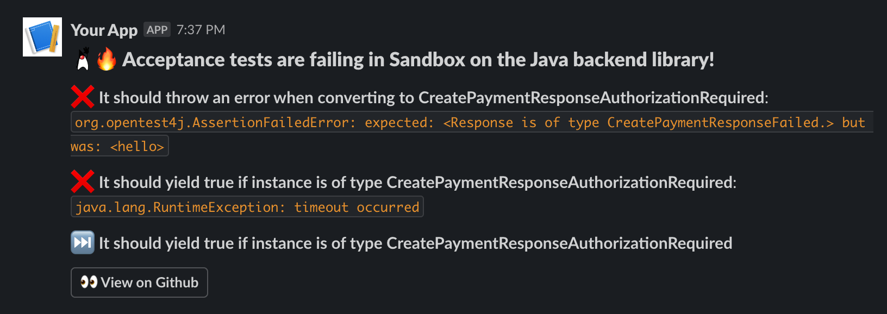

# Testvox: turns test reports into simple, human readable summaries

[](https://crates.io/crates/testvox)
[](https://hub.docker.com/r/adilisio/testvox)


Testvox is tiny Rust library with a very simple objective: turning test reports into human readable summaries, to be shared on common messaging apps.
The project simply deals with reports generation, it does not care about *sending* those reports.

It supports parsing test results from Junit XML and Mocha JSON formats and turning them into Slack messages. Support for more parsers and reporters may be added in the future.

Its primary use case is probably within CI pipelines, although it can be used as CLI and as library as well. 

# Use within CI

Currently, only Github Actions are supported.

## Use as Github action

To use this as Github action it is enough to place the following step after your tests are generated and right before sending the message. 
For Junit reports (default):
```yaml
  steps:

  # ... Steps that generate Junit XML test results ...

  - uses: dili91/testvox@v0.2.1 # Replace with the latest version
    name: Generate Slack report from Junit results
    # if: always() // might be needed, depending on your pipeline
    id: generate_junit_report
    with:
      title: "My Project - Junit Test Report"
      reports_pattern: "./test-results/**/*.xml" # Adjust to your Junit report path
      # report_type: junit # This is the default, can be omitted
      include_skipped: true
      # include_passed: true # Uncomment to include passed tests

  # ... Step that sends the report ...
```

To use it with Mocha JSON reports:

```yaml
  steps:

  # ... Steps that generate Mocha JSON test results ...

  - uses: dili91/testvox@v0.2.1 # Replace with the latest version
    name: Generate Slack report from Mocha JSON results
    # if: always() // might be needed, depending on your pipeline
    id: generate_mocha_report
    with:
      title: "My Project - Mocha Test Report"
      reports_pattern: "./test-results/**/*.json" # Adjust to your Mocha report path
      report_type: mocha # Specify Mocha parser
      include_skipped: true

  # ... Step that sends the report ...
```

Below, and in the [acceptance-test.yml](./.github/workflows/acceptance_tests.yml) file you can find a full example for Junit: 

```yaml

on: [push]

jobs:
  tests:
    name: Acceptance Tests
    runs-on: ubuntu-latest
    steps:
      - uses: actions/checkout@v4
      - uses: dili91/testvox@v0.2.1 # Replace with the latest version
        name: Generate Slack report from Junit results
        # if: always() // might be needed, depending on your pipeline
        id: generate_slack_report
        with:
          title: "${{ github.repository }} Junit Report" # Example title
          reports_pattern: "./test-results/**/*.xml" # Default pattern for Junit
          # report_type: junit # This is the default
          include_skipped: true
      - name: Send Slack report
        uses: slackapi/slack-github-action@v1.26.0
        with:
          payload: ${{steps.generate_slack_report.outputs.report}}
        env:
          SLACK_WEBHOOK_URL: ${{ secrets.SLACK_WEBHOOK_URL }}
          SLACK_WEBHOOK_TYPE: INCOMING_WEBHOOK

```

### Default configuration

The Github action has the following requirements and defaults values: 

| Name            | Required           | Default                                                                                | Description                                                                    |
|-----------------|--------------------|----------------------------------------------------------------------------------------|--------------------------------------------------------------------------------|
| title           | :white_check_mark: | `${{ github.repository }} test report`                                                 | The title of the test report.                                                  |
| reports_pattern | :white_check_mark: | `./build/test-results/*.xml`                                                           | Glob pattern for the test report files.                                        |
| report_type     | :x:                | `junit`                                                                                | Specifies the format of the test report. Accepted values: `junit`, `mocha`.    |
| include_skipped | :x:                | false                                                                                  | Whether to include skipped tests in the report.                                |
| include_passed  | :x:                | false                                                                                  | Whether to include passed tests in the report.                                 |
| link            | :x:                | `${{ github.server_url }}/${{ github.repository }}/actions/runs/${{ github.run_id }}`  | Optional link to view more details, e.g., a CI workflow run.                 |

# Use as CLI

Install the library locally:

```shell
cargo install testvox
```

then, invoke it from your terminal:

```shell
testvox --help

Turns test reports into human readable summaries, to be shared on common messaging apps

Usage: testvox [OPTIONS] --title <TITLE> --reports-pattern <REPORTS_PATTERN>...

Options:
  -t, --title <TITLE>
          The title of the test report
  -s, --include-skipped
          Whether to include skipped tests in the report
  -p, --include-passed
          Whether to include passed tests in the report
  -r, --reports-pattern <REPORTS_PATTERN>...
          The test report pattern to look for [default: ./build/test-results/**/*.xml,./app/build/test-results/**/*.xml]
      --report-type <REPORT_TYPE>
          The type of report to parse (e.g. junit, mocha) [default: junit]
  -l, --link <LINK>
          Optional link to view more details related to the report, usually a CI workflow
  -h, --help
          Print help
```
Note: The example `testvox --help` output above may not be fully up-to-date with all arguments (like `--report-type`). Always run `testvox --help` to see the most current options. The CLI supports `--report-type` (default: `junit`). Due to a potential conflict with short option flags (e.g. `-t`), it's recommended to use the long form arguments like `--report-type <TYPE>` and `--title <TITLE>` for clarity when using the CLI.


## With Docker

Optionally, you can get the same use the Docker image: 

```shell
docker run --platform=linux/amd64 -v $(PWD):/tmp adilisio/testvox:0.2.0 -p -t "Hello!" -r "/tmp/**/*.xml"


{
  "blocks": [
    {
      "type": "header",
      "text": {
        "type": "plain_text",
        "text": "Hello!",
        "emoji": true
      }
    },
    {
      "type": "divider"
    },
    {
      "type": "section",
      "text": {
        "type": "mrkdwn",
        "text": "✅ _/observe/health endpoint should return 200 and health information_ *passed* (`0.049s`)"
      }
    },
    {
      "type": "divider"
    },
    {
      "type": "section",
      "text": {
        "type": "mrkdwn",
        "text": "✅ _/posts endpoint should return 200 with a list of posts_ *passed* (`0.06s`)"
      }
    },
    {
      "type": "divider"
    },
    {
      "type": "section",
      "text": {
        "type": "mrkdwn",
        "text": "✅ _It should yield a Post mapper_ *passed* (`0.01s`)"
      }
    },
    {
      "type": "divider"
    },
    {
      "type": "section",
      "text": {
        "type": "mrkdwn",
        "text": "✅ _It should convert a raw DbRow object to a Post object_ *passed* (`0.616s`)"
      }
    }
  ]
}
```

# Use as library

Testvox can be also used as library when needed. You can install it by adding the crate to your project: 

```shell
cargo add testvox
```

You can then refer to its [create_test_report](https://docs.rs/testvox/latest/testvox/fn.create_test_report.html) function to start using it.